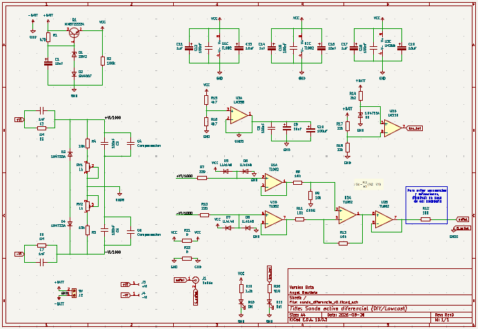
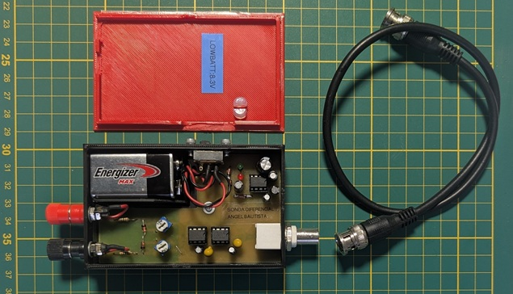
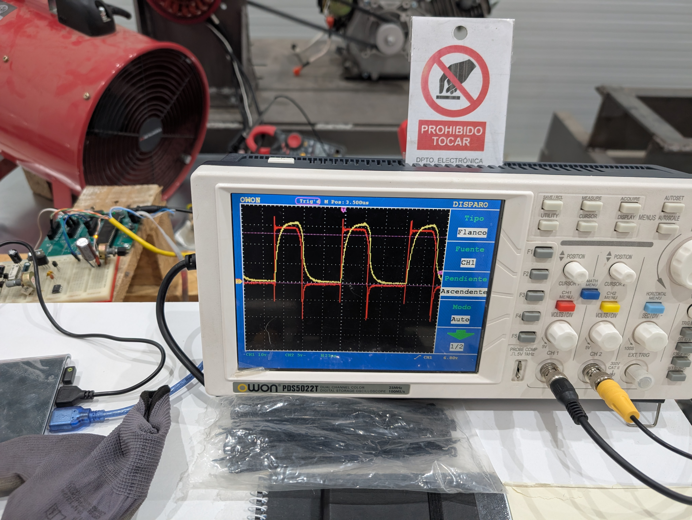

# SondaDiferencial
low cost (no fancy things) diferential probe 

<!-- Encabezado -->

    <h1>Sonda Diferencial de Baja Tensión de hasta 250Vp ( seno: 176,78Vrms) @ 100kHz </h1>
    
<i>Un proyecto para mediciones seguras y precisas con osciloscopio. Basado en componentes disponibles en cualquier laboratrio o tienda de electrónica, sin embargo el reto el cual afronte y te invito a seguirlo es el de replicar esta sonda con componentes disponibles es tus cajones</i>

    

<!-- Descripción del Proyecto -->
<h2>1. Descripción del Proyecto</h2>

    Esta <b>Sonda Diferencial</b> ha sido diseñada para permitir mediciones de señales flotantes usando un solo canal de un osciloscopio convencional sin riesgo de cortocircuitos a tierra o daños en el equipo de medición. 

    El circuito atenúa y convierte señales diferenciales en una señal referenciada a masa (single-ended) apta para las entradas estándar BNC (Vo: 3Vpp ) .

<!-- Esquemático -->
<h3>Esquemático del Circuito</h3>

    
    
<i>Figura 1: Esquemático general del circuito de la sonda diferencial.</i>

<!-- Licencia y Restricciones -->
<h2>2. Licencia y Restricciones</h2>

    Este proyecto está bajo la licencia <b>Creative Commons Attribution-NonCommercial-ShareAlike 3.0 Unported (CC BY-NC-SA 3.0)</b>.

<ul>
    <li><b>Atribución (BY):</b> Debe dar crédito de manera adecuada, brindar un enlace a la licencia e indicar si se han realizado cambios.</li>
    <li><b>No Comercial (NC):</b> <u>No puede utilizar este material para una finalidad comercial</u> ni para obtener una ventaja monetaria directa/indirecta sin la autorización previa del autor.</li>
    <li><b>Compartir Igual (SA):</b> Si remezcla, transforma o crea a partir del material, debe distribuir sus contribuciones bajo la misma licencia que el original.</li>
</ul>

<!-- Lista de Materiales (BOM) -->
<h2>3. Lista de Materiales (BOM)</h2>

A continuación se detallan los componentes principales necesarios para el ensamblaje:

<table border="1" cellpadding="6" cellspacing="0" style="width: 100%; border-collapse: collapse;">
    <thead>
        <tr style="background-color: #f1f3f5;">
            <th>Designador</th>
            <th>Valor / Descripción</th>
            <th>Cantidad</th>
            <th>Encapsulado / Footprint</th>
        </tr>
    </thead>
    <tbody>
        <tr><td><b>U1, U2</b></td><td>TL082 (Op-Amp JFET Dual)</td><td align="center">2</td><td>Package_DIP:DIP-8_W7.62mm_Socket</td></tr>
        <tr><td><b>U3</b></td><td>LM358 (Op-Amp Dual)</td><td align="center">1</td><td>Package_DIP:DIP-8_W7.62mm_Socket</td></tr>
        <tr><td><b>Q1</b></td><td>MMBT2222A (Transistor NPN)</td><td align="center">1</td><td>Package_TO_SOT_SMD:SOT-23</td></tr>
        <tr><td><b>D1</b></td><td>Z8V2 (Diodo Zener 8.2V)</td><td align="center">1</td><td>Diode_THT:D_DO-41_SOD81_P12.70mm</td></tr>
        <tr><td><b>D2</b></td><td>SM4007 (Diodo Rectificador)</td><td align="center">1</td><td>Diode_SMD:D_MELF</td></tr>
        <tr><td><b>D3, D4, D9</b></td><td>1N4733A (Diodo Zener 5.1V)</td><td align="center">3</td><td>Diode_THT:D_DO-41_SOD81_P10.16mm</td></tr>
        <tr><td><b>D5, D6, D7, D8</b></td><td>LL4148 (Diodo de Señal)</td><td align="center">4</td><td>Diode_SMD:D_MiniMELF</td></tr>
        <tr><td><b>D10</b></td><td>LED 3mm (Power ON)</td><td align="center">1</td><td>LED_THT:LED_D3.0mm</td></tr>
        <tr><td><b>D11</b></td><td>LED 3mm (Low Battery)</td><td align="center">1</td><td>LED_THT:LED_D3.0mm</td></tr>
        <tr><td><b>C1, C9, C13, C16, C19</b></td><td>10uF (Electrolítico)</td><td align="center">5</td><td>Capacitor_THT:CP_Radial_D5.0mm_P2.00mm</td></tr>
        <tr><td><b>C10</b></td><td>100uF (Electrolítico)</td><td align="center">1</td><td>Capacitor_THT:CP_Radial_D8.0mm_P3.50mm</td></tr>
        <tr><td><b>C11, C14, C17</b></td><td>1uF (Electrolítico)</td><td align="center">3</td><td>Capacitor_THT:CP_Radial_D4.0mm_P2.00mm</td></tr>
        <tr><td><b>C3, C5, C8, C12, C15, C18</b></td><td>100nF</td><td align="center">6</td><td>Capacitor_SMD:C_1206_3216Metric</td></tr>
        <tr><td><b>C2, C7</b></td><td>1nF</td><td align="center">2</td><td>Capacitor_SMD:C_1206_3216Metric</td></tr>
        <tr><td><b>C4, C6</b></td><td>Compensación</td><td align="center">2</td><td>Capacitor_SMD:C_1206_3216Metric</td></tr>
        <tr><td><b>R3, R6</b></td><td>1M (Resistencia Alto Voltaje)</td><td align="center">2</td><td>Resistor_THT:R_Axial_DIN0411</td></tr>
        <tr><td><b>R4, R5, R8, R9, R11, R13</b></td><td>10k</td><td align="center">6</td><td>Resistor_SMD:R_1206_3216Metric</td></tr>
        <tr><td><b>R15, R16</b></td><td>4k7</td><td align="center">2</td><td>Resistor_SMD:R_1206_3216Metric</td></tr>
        <tr><td><b>R7, R10</b></td><td>220</td><td align="center">2</td><td>Resistor_SMD:R_1206_3216Metric</td></tr>
        <tr><td><b>R21, R22</b></td><td>0 (Jumper)</td><td align="center">2</td><td>Resistor_SMD:R_1206_3216Metric</td></tr>
        <tr><td><b>R1</b></td><td>470</td><td align="center">1</td><td>Resistor_SMD:R_1206_3216Metric</td></tr>
        <tr><td><b>R2</b></td><td>100k</td><td align="center">1</td><td>Resistor_SMD:R_1206_3216Metric</td></tr>
        <tr><td><b>R12</b></td><td>100</td><td align="center">1</td><td>Resistor_SMD:R_1206_3216Metric</td></tr>
        <tr><td><b>R14</b></td><td>2k2</td><td align="center">1</td><td>Resistor_SMD:R_1206_3216Metric</td></tr>
        <tr><td><b>R17</b></td><td>22k</td><td align="center">1</td><td>Resistor_SMD:R_1206_3216Metric</td></tr>
        <tr><td><b>R18</b></td><td>33k</td><td align="center">1</td><td>Resistor_SMD:R_1206_3216Metric</td></tr>
        <tr><td><b>R19</b></td><td>1.2k</td><td align="center">1</td><td>Resistor_SMD:R_1206_3216Metric</td></tr>
        <tr><td><b>R20</b></td><td>910</td><td align="center">1</td><td>Resistor_SMD:R_1206_3216Metric</td></tr>
        <tr><td><b>RV1, RV2</b></td><td>1k (Trimmer)</td><td align="center">2</td><td>Potentiometer_THT:Potentiometer_Piher_PT-6-V</td></tr>
        <tr><td><b>J1</b></td><td>Conector BNC Salida</td><td align="center">1</td><td>Connector_Coaxial:BNC_Amphenol_B6252HB</td></tr>
        <tr><td><b>J2</b></td><td>Clema 2P Alimentación 9V</td><td align="center">1</td><td>TerminalBlock_MX126-5.0-02P</td></tr>
        <tr><td><b>J3, J4</b></td><td>Pin Header +Vi / -Vi</td><td align="center">2</td><td>Connector_PinHeader_2.54mm_1x01</td></tr>
    </tbody>
</table>

  
  
<i>Figura 2: Vista interior de la sonda diferencial.</i>

<!-- Cáculos de alimentación -->
<h2>4. Cálculos del sistema</h2>
<ul>
    <li>Cálculos de alimentación del TL082</li>
    

    El criterio de alimentación esta basado en dos caracteristicas: 
	

	 
1. Bandas de funcionamiento y alimenttación del TL082 
	EL voltaje efectivo que puede manejar el TL082 debe estar dentro de la ventanda de Vo_up = Vdd - 1,5V y Vo_down = Vss + 1,5V
	Por lo tanto si alimentamos el TL082 en configuracion diferencial con 8Vpp tendremos un Vo_max = 5Vpp, que referenciado a la tierra virtual seria +/- 2,5Vp. 
    

	

	2. Voltaje pico de salida de la sonda.
	El Vo_pp de la salida de la sonda debe ser <b> <= 5V </b>(Rango de voltaje en la entrada (conectores BNC) de los osciloscopio convencinales)
	

	

	
	
<i>Figura 3: Esquemático del regulador de Voltaje.</i>

	
 
<li>Cálculo de regunlación de voltaje</li>
    

   	Para la regulacion del voltaje de todo el sistema pude haber elegido componentes tan comunes y economicos como los LM78xx o LM317 (o versiones modernas) por mencionar algunos, sin embargo al ver que el requerimiento de potencia total es <b><= 230mW </b> 
	

</ul>

<li>Cálculo de consumo</li>
    <ul>
	<li>Regulador: 2mA</li>
  <li>Amplificador diferencial:7mA</li>
  <li>Buffer:4mA</li>
  <li>Gnd_virtual:4mA</li>
  <li>Detector_voltaje:5mA</li>
  <li>Led_rojo (Low_batt): 2,5mA</li>
  <li>Led_Verde (Power_ON): 2,5mA</li>
  
I_total = 27mA / Potencia: 221mW 
   

</ul>
   	

</ul>

<!-- Aplicaciones -->
<h2>5. Aplicaciones</h2>
<ul>
    <li>Medición en fuentes de alimentación conmutadas (SMPS) y etapas de potencia.</li>
    <li>Análisis de variadores de frecuencia (VFD) y drivers de motores.</li>
    <li>Diseño y prueba de circuitos Inverter y convertidores DC-DC.</li>
    <li>Medición segura en líneas de corriente alterna (AC) sin aislar el osciloscopio de tierra.</li>
</ul>

<!-- Demostración de Uso -->
<h2>6. Demostración de Uso</h2>

Instrucciones básicas para conectar y usar la sonda de manera segura:

<ol>
    <li>Conecte la salida BNC de la sonda diferencial al Canal 1 de su osciloscopio mediante un cable coaxial de 50&Omega;.</li>
    <li>Alimente la sonda diferencial (mediante batería interna 9V) Nota: Para efectos de este diseño básico y no optimizado el calculo del low-batt queda en 8.3Vdc. (ver calulos de alimentación)</li>
    <li>Asegúrese de seleccionar el factor de atenuación correcto en el osciloscopio (ej. 100x).</li>
    <li>Conecte las puntas de prueba a los puntos de medición flotantes de su circuito de prueba.</li>
</ol>

    
    
<i>Figura 4: Prueba de la sonda midiendo una señal en etapa de potencia.</i>

<!-- Archivos del Repositorio -->
<h2>7. Estructura de Archivos del Repositorio</h2>
<pre>
